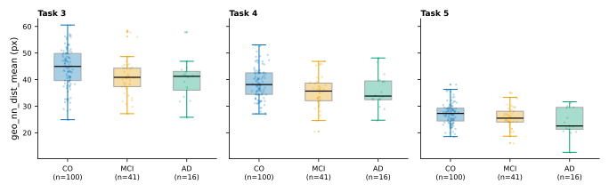
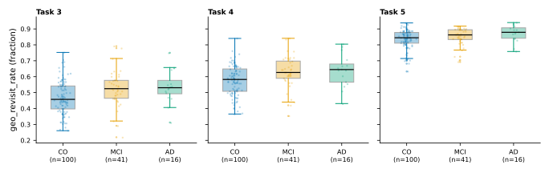
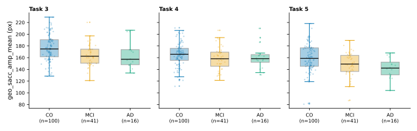
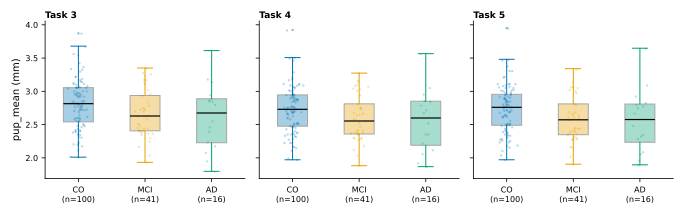
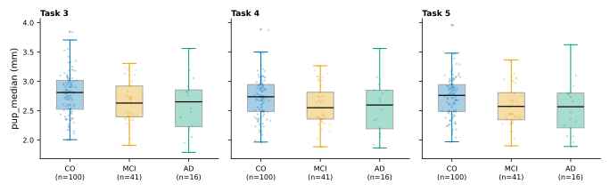
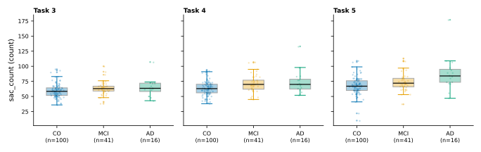
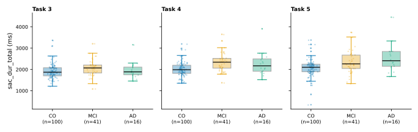
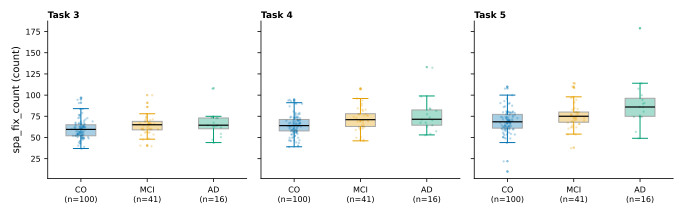

# BEGAD — Week 1 Report: Group Comparison (CO / MCI / AD)

## 1. Dataset overview

- **Session**: 2025-03-05, export tag `BEGAD_ETRA25`; 205 raw eye-tracking CSV
  exports (`dataset/20250305/`, `dataset_v2/20250305/`).
- **Cohort**: first-visit participants in groups CO / MCI / AD only (excluded:
  36 follow-up visits, 10 NPH participants (Group 3), 2 recordings with
  Group −11).

| Group | Participants |
|---|---|
| CO | 100 |
| MCI | 41 |
| AD | 16 |
| **Total** | **157** |

- **Protocol**: 11 tasks (0–10) per participant.

| Task | Media (`MediaName`) | Description |
|---|---|---|
| 0 | `Instruction Element` | Instruction screen |
| 1 | `KD_demo_highres.png` | King–Devick demo card (practice) |
| 2 | `Instruction Element 2` | Instruction screen |
| 3 | `KD_1_highres.png` | King–Devick card 1 |
| 4 | `KD_2_highres.png` | King–Devick card 2 |
| 5 | `KD_3_highres.png` | King–Devick card 3 |
| 6 | `Instruction Element` | Instruction screen |
| 7 | `lukeminen_harj.png` | Reading practice |
| 8 | `Instruction Element` | Instruction screen |
| 9 | `lukeminen_1.png` | Reading task |
| 10 | `Instruction Element 2` | Closing instruction screen |

- **Features**: 72 features per (participant, task) in
  `processed_dataset/features.csv` (1727 rows = 157 × 11; 2 all-NaN rows:
  `BEGCO-029`, `BEGMCI-019` × task 10).
- **Unit of analysis**: one feature value per (participant, task); within a
  task, the three groups are independent samples.

## 2. processed_dataset_v2 — 25 selected features

Screening criterion: Kruskal–Wallis **p < 0.1 (uncorrected) in at least 3 of
the 11 tasks**. Exploratory only — 792 tests were run in total, so multiple
testing is expected (q_bh in Table 1). The dataset restricted to these 25
features is `processed_dataset_v2/features.csv`.

| Feature | n_tasks (p<0.1) | Tasks |
|---|---|---|
| `pup_mean` | 9 | 2, 3, 4, 5, 6, 7, 8, 9, 10 |
| `pup_median` | 9 | 2, 3, 4, 5, 6, 7, 8, 9, 10 |
| `sac_dur_total` | 9 | 0, 1, 2, 3, 4, 5, 6, 7, 10 |
| `pup_max` | 7 | 0, 2, 5, 7, 8, 9, 10 |
| `pup_min` | 7 | 2, 5, 6, 7, 8, 9, 10 |
| `sac_count` | 7 | 0, 2, 3, 4, 5, 6, 7 |
| `spa_fix_count` | 7 | 0, 2, 3, 4, 5, 6, 7 |
| `geo_nn_dist_mean` | 6 | 0, 2, 3, 4, 5, 9 |
| `geo_revisit_rate` | 6 | 0, 1, 2, 3, 4, 5 |
| `geo_sacc_amp_mean` | 5 | 3, 4, 5, 7, 8 |
| `sac_amp_mean` | 5 | 3, 5, 7, 8, 10 |
| `spa_center_dist_std` | 5 | 1, 2, 4, 6, 9 |
| `geo_scanpath_len` | 4 | 0, 2, 4, 5 |
| `pup_std` | 4 | 1, 2, 9, 10 |
| `pupbl_std` | 4 | 1, 2, 9, 10 |
| `sac_dur_max` | 4 | 0, 2, 7, 10 |
| `sac_dur_mean` | 4 | 1, 3, 4, 9 |
| `tem_dur_total` | 4 | 0, 2, 4, 5 |
| `pup_slope` | 3 | 1, 2, 10 |
| `pupbl_slope` | 3 | 1, 2, 10 |
| `sac_amp_std` | 3 | 3, 5, 10 |
| `sac_turn_std` | 3 | 0, 8, 9 |
| `spa_dispersion` | 3 | 3, 8, 9 |
| `spa_q2` | 3 | 0, 3, 10 |
| `tem_velocity_mean` | 3 | 3, 5, 8 |

### 2.1 Definitions of the 25 selected features

Each feature is one scalar per (participant, task), computed from the clean
fixations of that pair (`src/begad_norm/features/`). Notation: `n` = number of
clean fixations; `x, y` = fixation centers (`FixationPointX/Y (MCSpx)`, px,
media-relative); `dur` = fixation duration (`GazeEventDuration`, ms); `pup` =
binocular mean pupil `(PupilLeft + PupilRight) / 2` (mm); `(cx, cy) = (W/2,
H/2)` = media center from `TASK_GEOMETRY` (config.py). All stds use `ddof=1`
(sample SD). The full 72-feature dictionary: `EDA/features_dictionary.md`.

| Feature | Meaning | How it is computed | Unit |
|---|---|---|---|
| **Pupil — pupil size and dynamics (series in fixation-time order)** | | | |
| `pup_mean` | Average pupil size during the task | `mean(pup_i)` with `pup_i = (PupilLeft_i + PupilRight_i) / 2` over the clean fixations | mm |
| `pup_median` | Median pupil size | `median(pup_i)` | mm |
| `pup_max` / `pup_min` | Largest / smallest pupil size | `max` / `min` of the series | mm |
| `pup_std` | Variability of pupil size | sample SD (`ddof=1`) of the series | mm |
| `pup_slope` | Pupil trend over the task (positive = dilation, negative = constriction) | slope of the least-squares line (`np.polyfit`, degree 1) of the series over fixation order `0…n−1` | mm per fixation index |
| `pupbl_std` | Variability after baseline correction | as `pup_std` on the baseline-corrected series `((PupilLeft_i − PupilLeftBaseline) + (PupilRight_i − PupilRightBaseline)) / 2` (baselines constant per recording) | mm |
| `pupbl_slope` | Baseline-corrected pupil trend | as `pup_slope` on the baseline-corrected series | mm per fixation index |
| **Saccade — measured saccade events (`Final` rows collapsed into runs)** | | | |
| `sac_count` | Number of saccades | `m` = number of saccade runs (consecutive `Final` saccade rows in time order sharing the same landing fixation) | count |
| `sac_dur_total` | Total time spent in saccades | sum of run durations; `run_dur` = max `GazeEventDuration` within the run | ms |
| `sac_dur_mean` | Average saccade duration | mean of the run durations | ms |
| `sac_dur_max` | Longest saccade | max of the run durations | ms |
| `sac_amp_mean` | Average saccade amplitude | mean of the per-fixation `SaccadicAmplitude` (amplitude of the saccade landing on each fixation) | deg (visual angle) |
| `sac_amp_std` | Variability of saccade amplitude | sample SD (`ddof=1`) of those amplitudes | deg |
| `sac_turn_std` | Variability of direction changes between consecutive saccades | sample SD (`ddof=1`) of `min(reldir, 360 − reldir)` from `RelativeSaccadicDirection`, folded to `[0, 180]` | deg |
| **Spatial — fixation positions and spread** | | | |
| `spa_fix_count` | Number of fixations | `n` = clean fixations remaining after cleaning | count |
| `spa_center_dist_std` | Spread of the fixations around the media center | sample SD (`ddof=1`) of the distances `sqrt((x−cx)² + (y−cy)²)` | px |
| `spa_dispersion` | Average distance of the fixations from their centroid | `mean(sqrt((x−mean(x))² + (y−mean(y))²))` | px |
| `spa_q2` | Share of fixations in quadrant q2 (right of center, upper half) | fraction of fixations with `x ≥ cx` and `y < cy` | fraction 0–1 |
| **Geometry — scanpath shape (inferred saccades between consecutive fixations)** | | | |
| `geo_scanpath_len` | Total scanpath length | sum of step lengths `amp = sqrt(dx² + dy²)`, `dx = diff(x)`, `dy = diff(y)` | px |
| `geo_sacc_amp_mean` | Average step (inferred saccade) amplitude | `mean(amp)` | px |
| `geo_nn_dist_mean` | Spacing of the fixations (how dense the scanpath is) | mean over fixations of the distance to the nearest *other* fixation | px |
| `geo_revisit_rate` | Tendency to return to already visited locations | fraction of fixations with a *later* fixation within 60 px (`REVISIT_RADIUS`; forward-looking, `triu(dist < 60, k = 1)`) | fraction 0–1 |
| **Temporal — timing** | | | |
| `tem_dur_total` | Total fixation time | sum of the fixation durations | ms |
| `tem_velocity_mean` | Average scanpath velocity | mean of `amp / half_gap` over the finite terms, `half_gap = (dur_i + dur_{i+1}) / 2` (half-dwell inter-fixation interval approximation; onset timestamps are not recorded) | px/ms |

NaN rules: `pupbl_*` is NaN for the 16 participants whose pupil baselines are
missing in the raw data (in Table 1 their n is 89/38/14 for CO/MCI/AD instead
of 100/41/16); pairs with `n < 2` get an all-NaN row (`BEGCO-029`,
`BEGMCI-019` × task 10); `sac_dur_*` is NaN if `m = 0`; `pup_slope`,
`pupbl_slope`, `geo_*` are NaN if `n < 2`; `tem_velocity_mean` is NaN if no
`amp / half_gap` term is finite.

## 3. Group comparison table — H and p for the 25 features × 11 tasks

**Table 1.** Kruskal–Wallis H, uncorrected p, Benjamini–Hochberg q_bh, and
group means with n, for the 25 selected features in each of the 11 tasks.

| Task | Feature | H | p | q_bh | CO mean (n) | MCI mean (n) | AD mean (n) |
|---|---|---|---|---|---|---|---|
| 0 | `pup_mean` | 4.34 | 0.1139 | 0.4852 | 3.286 (100) | 3.103 (41) | 3.228 (16) |
| 0 | `pup_median` | 4.35 | 0.1137 | 0.4852 | 3.287 (100) | 3.104 (41) | 3.231 (16) |
| 0 | `sac_dur_total` | 28.23 | 7.39e-07 | 0.0006 | 1473 (100) | 1699 (41) | 2148 (16) |
| 0 | `pup_max` | 4.78 | 0.0916 | 0.4685 | 3.522 (100) | 3.322 (41) | 3.438 (16) |
| 0 | `pup_min` | 3.12 | 0.2099 | 0.6249 | 3.019 (100) | 2.862 (41) | 2.963 (16) |
| 0 | `sac_count` | 17.74 | 0.0001 | 0.0199 | 42.42 (100) | 47.68 (41) | 57 (16) |
| 0 | `spa_fix_count` | 17.60 | 0.0002 | 0.0199 | 43.35 (100) | 48.32 (41) | 58.06 (16) |
| 0 | `geo_nn_dist_mean` | 13.53 | 0.0012 | 0.0652 | 52.75 (100) | 49.42 (41) | 42.14 (16) |
| 0 | `geo_revisit_rate` | 18.02 | 0.0001 | 0.0199 | 0.3766 (100) | 0.4091 (41) | 0.5162 (16) |
| 0 | `geo_sacc_amp_mean` | 0.86 | 0.6493 | 0.8952 | 203.7 (100) | 199.8 (41) | 204.5 (16) |
| 0 | `sac_amp_mean` | 0.51 | 0.7740 | 0.9343 | 5.335 (100) | 5.209 (41) | 5.425 (16) |
| 0 | `spa_center_dist_std` | 4.54 | 0.1035 | 0.4714 | 141.3 (100) | 149.1 (41) | 149.4 (16) |
| 0 | `geo_scanpath_len` | 16.52 | 0.0003 | 0.0241 | 8598 (100) | 9366 (41) | 1.155e+04 (16) |
| 0 | `pup_std` | 1.71 | 0.4251 | 0.7917 | 0.1205 (100) | 0.108 (41) | 0.1078 (16) |
| 0 | `pupbl_std` | 1.91 | 0.3840 | 0.7700 | 0.1233 (89) | 0.1091 (38) | 0.1102 (14) |
| 0 | `sac_dur_max` | 6.07 | 0.0482 | 0.4044 | 88.13 (100) | 96.61 (41) | 104.9 (16) |
| 0 | `sac_dur_mean` | 1.45 | 0.4850 | 0.8297 | 34.86 (100) | 36.08 (41) | 38.77 (16) |
| 0 | `tem_dur_total` | 10.36 | 0.0056 | 0.1539 | 9451 (100) | 1.046e+04 (41) | 1.231e+04 (16) |
| 0 | `pup_slope` | 2.45 | 0.2931 | 0.7034 | 0.004948 (100) | 0.003636 (41) | 0.003742 (16) |
| 0 | `pupbl_slope` | 2.85 | 0.2400 | 0.6486 | 0.005244 (89) | 0.004045 (38) | 0.003794 (14) |
| 0 | `sac_amp_std` | 0.10 | 0.9511 | 0.9885 | 5.118 (100) | 5.156 (41) | 5.219 (16) |
| 0 | `sac_turn_std` | 9.72 | 0.0077 | 0.1856 | 78.02 (100) | 76.88 (41) | 74.29 (16) |
| 0 | `spa_dispersion` | 1.31 | 0.5195 | 0.8414 | 255.2 (100) | 256.1 (41) | 250.2 (16) |
| 0 | `spa_q2` | 8.40 | 0.0150 | 0.2696 | 0.2277 (100) | 0.1904 (41) | 0.1937 (16) |
| 0 | `tem_velocity_mean` | 1.33 | 0.5131 | 0.8397 | 1.065 (100) | 1.033 (41) | 1.145 (16) |
| 1 | `pup_mean` | 3.85 | 0.1461 | 0.5406 | 2.848 (100) | 2.719 (41) | 2.713 (16) |
| 1 | `pup_median` | 3.86 | 0.1452 | 0.5406 | 2.841 (100) | 2.711 (41) | 2.689 (16) |
| 1 | `sac_dur_total` | 6.89 | 0.0319 | 0.3962 | 1337 (100) | 1490 (41) | 1529 (16) |
| 1 | `pup_max` | 3.99 | 0.1357 | 0.5348 | 3.178 (100) | 3.015 (41) | 3.174 (16) |
| 1 | `pup_min` | 3.50 | 0.1737 | 0.5847 | 2.601 (100) | 2.49 (41) | 2.485 (16) |
| 1 | `sac_count` | 1.71 | 0.4244 | 0.7917 | 43.59 (100) | 45.71 (41) | 48.19 (16) |
| 1 | `spa_fix_count` | 1.93 | 0.3804 | 0.7686 | 44.44 (100) | 46.61 (41) | 49.56 (16) |
| 1 | `geo_nn_dist_mean` | 4.52 | 0.1043 | 0.4714 | 50.54 (100) | 48.28 (41) | 44.87 (16) |
| 1 | `geo_revisit_rate` | 6.75 | 0.0342 | 0.3962 | 0.398 (100) | 0.4321 (41) | 0.4679 (16) |
| 1 | `geo_sacc_amp_mean` | 1.46 | 0.4825 | 0.8290 | 159.4 (100) | 160.5 (41) | 153.9 (16) |
| 1 | `sac_amp_mean` | 1.02 | 0.6000 | 0.8756 | 4.181 (100) | 4.088 (41) | 4.014 (16) |
| 1 | `spa_center_dist_std` | 8.16 | 0.0169 | 0.2846 | 96.74 (100) | 93.48 (41) | 92.02 (16) |
| 1 | `geo_scanpath_len` | 1.23 | 0.5394 | 0.8439 | 6814 (100) | 7151 (41) | 7438 (16) |
| 1 | `pup_std` | 5.98 | 0.0504 | 0.4044 | 0.1254 (100) | 0.1155 (41) | 0.1453 (16) |
| 1 | `pupbl_std` | 5.30 | 0.0707 | 0.4438 | 0.1281 (89) | 0.1178 (38) | 0.1461 (14) |
| 1 | `sac_dur_max` | 3.15 | 0.2070 | 0.6210 | 76.82 (100) | 85.78 (41) | 88.75 (16) |
| 1 | `sac_dur_mean` | 8.01 | 0.0183 | 0.2952 | 30.88 (100) | 33.16 (41) | 32.25 (16) |
| 1 | `tem_dur_total` | 1.27 | 0.5292 | 0.8433 | 1.254e+04 (100) | 1.328e+04 (41) | 1.395e+04 (16) |
| 1 | `pup_slope` | 9.57 | 0.0084 | 0.1917 | -0.003653 (100) | -0.003726 (41) | -0.007268 (16) |
| 1 | `pupbl_slope` | 9.10 | 0.0106 | 0.2151 | -0.003914 (89) | -0.003698 (38) | -0.007063 (14) |
| 1 | `sac_amp_std` | 1.25 | 0.5355 | 0.8439 | 3.719 (100) | 3.645 (41) | 3.483 (16) |
| 1 | `sac_turn_std` | 0.16 | 0.9241 | 0.9772 | 71.38 (100) | 70.98 (41) | 71.11 (16) |
| 1 | `spa_dispersion` | 1.61 | 0.4477 | 0.8053 | 249.7 (100) | 248.4 (41) | 236.9 (16) |
| 1 | `spa_q2` | 1.21 | 0.5459 | 0.8439 | 0.1866 (100) | 0.1904 (41) | 0.1897 (16) |
| 1 | `tem_velocity_mean` | 0.05 | 0.9770 | 0.9926 | 0.6694 (100) | 0.6728 (41) | 0.669 (16) |
| 2 | `pup_mean` | 4.68 | 0.0965 | 0.4685 | 3.179 (100) | 2.994 (41) | 3.088 (16) |
| 2 | `pup_median` | 4.65 | 0.0976 | 0.4685 | 3.204 (100) | 3.011 (41) | 3.13 (16) |
| 2 | `sac_dur_total` | 23.04 | 9.94e-06 | 0.0039 | 1010 (100) | 1181 (41) | 1260 (16) |
| 2 | `pup_max` | 4.87 | 0.0875 | 0.4636 | 3.402 (100) | 3.198 (41) | 3.314 (16) |
| 2 | `pup_min` | 4.91 | 0.0858 | 0.4594 | 2.753 (100) | 2.633 (41) | 2.587 (16) |
| 2 | `sac_count` | 10.24 | 0.0060 | 0.1580 | 28.27 (100) | 31.17 (41) | 34.62 (16) |
| 2 | `spa_fix_count` | 10.49 | 0.0053 | 0.1539 | 29.1 (100) | 32.02 (41) | 35.5 (16) |
| 2 | `geo_nn_dist_mean` | 4.71 | 0.0951 | 0.4685 | 52.9 (100) | 52.01 (41) | 46.21 (16) |
| 2 | `geo_revisit_rate` | 6.06 | 0.0483 | 0.4044 | 0.3692 (100) | 0.3945 (41) | 0.4539 (16) |
| 2 | `geo_sacc_amp_mean` | 0.68 | 0.7124 | 0.9198 | 223.5 (100) | 222.1 (41) | 225.5 (16) |
| 2 | `sac_amp_mean` | 0.73 | 0.6951 | 0.9138 | 5.763 (100) | 5.741 (41) | 5.856 (16) |
| 2 | `spa_center_dist_std` | 5.63 | 0.0601 | 0.4209 | 143.5 (100) | 151.5 (41) | 139.9 (16) |
| 2 | `geo_scanpath_len` | 11.40 | 0.0033 | 0.1185 | 6186 (100) | 6801 (41) | 7630 (16) |
| 2 | `pup_std` | 6.48 | 0.0391 | 0.3971 | 0.1584 (100) | 0.133 (41) | 0.1773 (16) |
| 2 | `pupbl_std` | 5.89 | 0.0526 | 0.4086 | 0.161 (89) | 0.1353 (38) | 0.1774 (14) |
| 2 | `sac_dur_max` | 5.02 | 0.0814 | 0.4507 | 86.81 (100) | 98.49 (41) | 96.06 (16) |
| 2 | `sac_dur_mean` | 4.26 | 0.1187 | 0.5002 | 36.11 (100) | 38.13 (41) | 37.42 (16) |
| 2 | `tem_dur_total` | 5.49 | 0.0643 | 0.4318 | 6356 (100) | 6945 (41) | 7294 (16) |
| 2 | `pup_slope` | 5.79 | 0.0554 | 0.4209 | 0.01411 (100) | 0.0104 (41) | 0.01325 (16) |
| 2 | `pupbl_slope` | 5.38 | 0.0679 | 0.4407 | 0.01438 (89) | 0.01077 (38) | 0.01371 (14) |
| 2 | `sac_amp_std` | 0.55 | 0.7597 | 0.9343 | 5.321 (100) | 5.282 (41) | 5.207 (16) |
| 2 | `sac_turn_std` | 1.71 | 0.4259 | 0.7917 | 78.04 (100) | 77.2 (41) | 78.37 (16) |
| 2 | `spa_dispersion` | 0.83 | 0.6587 | 0.8980 | 245.7 (100) | 248.3 (41) | 240.5 (16) |
| 2 | `spa_q2` | 1.96 | 0.3745 | 0.7645 | 0.2389 (100) | 0.2269 (41) | 0.1991 (16) |
| 2 | `tem_velocity_mean` | 1.21 | 0.5466 | 0.8439 | 1.179 (100) | 1.139 (41) | 1.258 (16) |
| 3 | `pup_mean` | 4.73 | 0.0938 | 0.4685 | 2.8 (100) | 2.665 (41) | 2.621 (16) |
| 3 | `pup_median` | 5.15 | 0.0761 | 0.4461 | 2.787 (100) | 2.647 (41) | 2.6 (16) |
| 3 | `sac_dur_total` | 6.52 | 0.0385 | 0.3971 | 1911 (100) | 2056 (41) | 1966 (16) |
| 3 | `pup_max` | 3.25 | 0.1965 | 0.6055 | 3.142 (100) | 2.996 (41) | 3.016 (16) |
| 3 | `pup_min` | 4.14 | 0.1263 | 0.5140 | 2.57 (100) | 2.45 (41) | 2.411 (16) |
| 3 | `sac_count` | 6.66 | 0.0357 | 0.3971 | 59.3 (100) | 63.56 (41) | 64.5 (16) |
| 3 | `spa_fix_count` | 7.70 | 0.0213 | 0.3044 | 60.03 (100) | 64.32 (41) | 65.69 (16) |
| 3 | `geo_nn_dist_mean` | 11.34 | 0.0034 | 0.1185 | 44.27 (100) | 40.94 (41) | 39.94 (16) |
| 3 | `geo_revisit_rate` | 11.58 | 0.0031 | 0.1152 | 0.4703 (100) | 0.524 (41) | 0.537 (16) |
| 3 | `geo_sacc_amp_mean` | 12.28 | 0.0022 | 0.0896 | 176.8 (100) | 164.4 (41) | 164.5 (16) |
| 3 | `sac_amp_mean` | 13.22 | 0.0013 | 0.0690 | 4.585 (100) | 4.159 (41) | 4.194 (16) |
| 3 | `spa_center_dist_std` | 2.60 | 0.2732 | 0.6866 | 95.57 (100) | 97.32 (41) | 97.5 (16) |
| 3 | `geo_scanpath_len` | 0.10 | 0.9508 | 0.9885 | 1.028e+04 (100) | 1.026e+04 (41) | 1.048e+04 (16) |
| 3 | `pup_std` | 0.54 | 0.7650 | 0.9343 | 0.12 (100) | 0.1172 (41) | 0.1181 (16) |
| 3 | `pupbl_std` | 0.78 | 0.6762 | 0.9046 | 0.1226 (89) | 0.118 (38) | 0.1196 (14) |
| 3 | `sac_dur_max` | 1.05 | 0.5929 | 0.8696 | 79.8 (100) | 87.51 (41) | 89.44 (16) |
| 3 | `sac_dur_mean` | 4.99 | 0.0826 | 0.4543 | 32.47 (100) | 32.47 (41) | 30.88 (16) |
| 3 | `tem_dur_total` | 2.24 | 0.3264 | 0.7138 | 1.72e+04 (100) | 1.876e+04 (41) | 1.871e+04 (16) |
| 3 | `pup_slope` | 0.08 | 0.9630 | 0.9926 | -0.003368 (100) | -0.00358 (41) | -0.003563 (16) |
| 3 | `pupbl_slope` | 0.19 | 0.9091 | 0.9709 | -0.003517 (89) | -0.003589 (38) | -0.003652 (14) |
| 3 | `sac_amp_std` | 6.17 | 0.0457 | 0.4044 | 4.196 (100) | 3.9 (41) | 3.871 (16) |
| 3 | `sac_turn_std` | 3.31 | 0.1907 | 0.6055 | 74.21 (100) | 73.18 (41) | 73.4 (16) |
| 3 | `spa_dispersion` | 5.12 | 0.0772 | 0.4461 | 243.4 (100) | 238.6 (41) | 236.7 (16) |
| 3 | `spa_q2` | 5.29 | 0.0711 | 0.4438 | 0.2365 (100) | 0.2297 (41) | 0.2052 (16) |
| 3 | `tem_velocity_mean` | 5.74 | 0.0566 | 0.4209 | 0.728 (100) | 0.6651 (41) | 0.6809 (16) |
| 4 | `pup_mean` | 5.27 | 0.0718 | 0.4438 | 2.727 (100) | 2.598 (41) | 2.555 (16) |
| 4 | `pup_median` | 5.50 | 0.0639 | 0.4318 | 2.726 (100) | 2.596 (41) | 2.555 (16) |
| 4 | `sac_dur_total` | 19.63 | 5.47e-05 | 0.0144 | 2009 (100) | 2329 (41) | 2279 (16) |
| 4 | `pup_max` | 4.53 | 0.1041 | 0.4714 | 2.915 (100) | 2.778 (41) | 2.725 (16) |
| 4 | `pup_min` | 4.14 | 0.1264 | 0.5140 | 2.547 (100) | 2.433 (41) | 2.392 (16) |
| 4 | `sac_count` | 11.17 | 0.0037 | 0.1236 | 63.6 (100) | 71.12 (41) | 73.94 (16) |
| 4 | `spa_fix_count` | 12.38 | 0.0021 | 0.0896 | 64.66 (100) | 72.32 (41) | 75.5 (16) |
| 4 | `geo_nn_dist_mean` | 8.21 | 0.0165 | 0.2834 | 38.49 (100) | 35.48 (41) | 35.81 (16) |
| 4 | `geo_revisit_rate` | 10.91 | 0.0043 | 0.1353 | 0.5766 (100) | 0.6285 (41) | 0.637 (16) |
| 4 | `geo_sacc_amp_mean` | 5.04 | 0.0804 | 0.4497 | 165.2 (100) | 158.6 (41) | 161.4 (16) |
| 4 | `sac_amp_mean` | 3.98 | 0.1370 | 0.5348 | 4.323 (100) | 4.123 (41) | 4.199 (16) |
| 4 | `spa_center_dist_std` | 5.17 | 0.0755 | 0.4461 | 94.92 (100) | 96.88 (41) | 93.7 (16) |
| 4 | `geo_scanpath_len` | 8.62 | 0.0134 | 0.2506 | 1.039e+04 (100) | 1.115e+04 (41) | 1.181e+04 (16) |
| 4 | `pup_std` | 2.77 | 0.2501 | 0.6646 | 0.08282 (100) | 0.07534 (41) | 0.06865 (16) |
| 4 | `pupbl_std` | 2.82 | 0.2439 | 0.6571 | 0.0836 (89) | 0.07579 (38) | 0.06979 (14) |
| 4 | `sac_dur_max` | 2.70 | 0.2588 | 0.6788 | 78.38 (100) | 87.02 (41) | 81.81 (16) |
| 4 | `sac_dur_mean` | 4.93 | 0.0850 | 0.4580 | 31.84 (100) | 33.09 (41) | 31.08 (16) |
| 4 | `tem_dur_total` | 6.01 | 0.0496 | 0.4044 | 1.754e+04 (100) | 1.973e+04 (41) | 2.051e+04 (16) |
| 4 | `pup_slope` | 2.91 | 0.2336 | 0.6448 | -0.001569 (100) | -0.001137 (41) | -0.001183 (16) |
| 4 | `pupbl_slope` | 2.71 | 0.2584 | 0.6788 | -0.001604 (89) | -0.001173 (38) | -0.00129 (14) |
| 4 | `sac_amp_std` | 1.34 | 0.5113 | 0.8397 | 3.615 (100) | 3.456 (41) | 3.595 (16) |
| 4 | `sac_turn_std` | 3.33 | 0.1892 | 0.6055 | 74.68 (100) | 73.11 (41) | 73.44 (16) |
| 4 | `spa_dispersion` | 1.73 | 0.4213 | 0.7917 | 225.9 (100) | 222 (41) | 227.4 (16) |
| 4 | `spa_q2` | 3.71 | 0.1567 | 0.5692 | 0.229 (100) | 0.2136 (41) | 0.2018 (16) |
| 4 | `tem_velocity_mean` | 0.69 | 0.7086 | 0.9186 | 0.7038 (100) | 0.6998 (41) | 0.698 (16) |
| 5 | `pup_mean` | 6.52 | 0.0384 | 0.3971 | 2.737 (100) | 2.596 (41) | 2.559 (16) |
| 5 | `pup_median` | 6.56 | 0.0377 | 0.3971 | 2.734 (100) | 2.595 (41) | 2.553 (16) |
| 5 | `sac_dur_total` | 13.71 | 0.0011 | 0.0642 | 2077 (100) | 2322 (41) | 2545 (16) |
| 5 | `pup_max` | 5.61 | 0.0607 | 0.4209 | 2.911 (100) | 2.76 (41) | 2.734 (16) |
| 5 | `pup_min` | 6.42 | 0.0404 | 0.3999 | 2.581 (100) | 2.456 (41) | 2.394 (16) |
| 5 | `sac_count` | 15.91 | 0.0004 | 0.0253 | 67.81 (100) | 74.66 (41) | 87.81 (16) |
| 5 | `spa_fix_count` | 17.12 | 0.0002 | 0.0216 | 69.1 (100) | 76.2 (41) | 89.81 (16) |
| 5 | `geo_nn_dist_mean` | 7.26 | 0.0265 | 0.3471 | 27.21 (100) | 25.79 (41) | 24.16 (16) |
| 5 | `geo_revisit_rate` | 7.52 | 0.0233 | 0.3235 | 0.837 (100) | 0.8518 (41) | 0.8718 (16) |
| 5 | `geo_sacc_amp_mean` | 13.15 | 0.0014 | 0.0690 | 159.6 (100) | 148.3 (41) | 142.3 (16) |
| 5 | `sac_amp_mean` | 9.94 | 0.0069 | 0.1717 | 4.178 (100) | 3.863 (41) | 3.727 (16) |
| 5 | `spa_center_dist_std` | 2.64 | 0.2668 | 0.6838 | 99.42 (100) | 99 (41) | 98.13 (16) |
| 5 | `geo_scanpath_len` | 10.36 | 0.0056 | 0.1539 | 1.077e+04 (100) | 1.102e+04 (41) | 1.228e+04 (16) |
| 5 | `pup_std` | 0.79 | 0.6751 | 0.9046 | 0.07276 (100) | 0.06602 (41) | 0.07247 (16) |
| 5 | `pupbl_std` | 0.31 | 0.8554 | 0.9564 | 0.07197 (89) | 0.06684 (38) | 0.07022 (14) |
| 5 | `sac_dur_max` | 0.47 | 0.7917 | 0.9387 | 79.05 (100) | 76.49 (41) | 81.5 (16) |
| 5 | `sac_dur_mean` | 2.44 | 0.2956 | 0.7058 | 30.93 (100) | 31.21 (41) | 29.55 (16) |
| 5 | `tem_dur_total` | 16.41 | 0.0003 | 0.0241 | 1.848e+04 (100) | 2.115e+04 (41) | 2.524e+04 (16) |
| 5 | `pup_slope` | 2.66 | 0.2640 | 0.6824 | -0.00105 (100) | -0.000739 (41) | -0.001016 (16) |
| 5 | `pupbl_slope` | 2.56 | 0.2774 | 0.6866 | -0.001079 (89) | -0.0007318 (38) | -0.0009479 (14) |
| 5 | `sac_amp_std` | 5.13 | 0.0769 | 0.4461 | 3.76 (100) | 3.517 (41) | 3.328 (16) |
| 5 | `sac_turn_std` | 0.43 | 0.8075 | 0.9503 | 74.35 (100) | 74.17 (41) | 74.44 (16) |
| 5 | `spa_dispersion` | 0.80 | 0.6704 | 0.9046 | 199.4 (100) | 198.7 (41) | 197.6 (16) |
| 5 | `spa_q2` | 3.42 | 0.1809 | 0.5885 | 0.2975 (100) | 0.2798 (41) | 0.2629 (16) |
| 5 | `tem_velocity_mean` | 7.69 | 0.0213 | 0.3044 | 0.6661 (100) | 0.6234 (41) | 0.594 (16) |
| 6 | `pup_mean` | 5.09 | 0.0783 | 0.4493 | 3.155 (100) | 2.965 (41) | 3.079 (16) |
| 6 | `pup_median` | 4.87 | 0.0878 | 0.4636 | 3.167 (100) | 2.972 (41) | 3.097 (16) |
| 6 | `sac_dur_total` | 12.91 | 0.0016 | 0.0732 | 1642 (100) | 1757 (41) | 1995 (16) |
| 6 | `pup_max` | 4.38 | 0.1117 | 0.4852 | 3.428 (100) | 3.242 (41) | 3.302 (16) |
| 6 | `pup_min` | 5.23 | 0.0730 | 0.4438 | 2.721 (100) | 2.574 (41) | 2.624 (16) |
| 6 | `sac_count` | 9.29 | 0.0096 | 0.2103 | 45.03 (100) | 47.34 (41) | 53.25 (16) |
| 6 | `spa_fix_count` | 9.25 | 0.0098 | 0.2103 | 45.9 (100) | 48.17 (41) | 54.12 (16) |
| 6 | `geo_nn_dist_mean` | 3.63 | 0.1630 | 0.5746 | 51.66 (100) | 51.15 (41) | 46.37 (16) |
| 6 | `geo_revisit_rate` | 1.01 | 0.6020 | 0.8756 | 0.3792 (100) | 0.3881 (41) | 0.4089 (16) |
| 6 | `geo_sacc_amp_mean` | 3.75 | 0.1537 | 0.5620 | 222.7 (100) | 211.3 (41) | 212.7 (16) |
| 6 | `sac_amp_mean` | 3.25 | 0.1973 | 0.6055 | 5.728 (100) | 5.41 (41) | 5.49 (16) |
| 6 | `spa_center_dist_std` | 5.14 | 0.0764 | 0.4461 | 132.7 (100) | 137.9 (41) | 131.5 (16) |
| 6 | `geo_scanpath_len` | 3.92 | 0.1412 | 0.5406 | 9883 (100) | 9844 (41) | 1.12e+04 (16) |
| 6 | `pup_std` | 0.51 | 0.7758 | 0.9343 | 0.1569 (100) | 0.1486 (41) | 0.1402 (16) |
| 6 | `pupbl_std` | 1.01 | 0.6029 | 0.8756 | 0.1614 (89) | 0.1515 (38) | 0.1375 (14) |
| 6 | `sac_dur_max` | 4.05 | 0.1318 | 0.5246 | 95.28 (100) | 98.46 (41) | 112 (16) |
| 6 | `sac_dur_mean` | 0.62 | 0.7331 | 0.9231 | 36.7 (100) | 37.25 (41) | 38.02 (16) |
| 6 | `tem_dur_total` | 3.25 | 0.1966 | 0.6055 | 9986 (100) | 1.04e+04 (41) | 1.128e+04 (16) |
| 6 | `pup_slope` | 2.39 | 0.3034 | 0.7058 | 0.009163 (100) | 0.008573 (41) | 0.006461 (16) |
| 6 | `pupbl_slope` | 3.01 | 0.2224 | 0.6360 | 0.00955 (89) | 0.008818 (38) | 0.006572 (14) |
| 6 | `sac_amp_std` | 0.11 | 0.9461 | 0.9885 | 5.316 (100) | 5.292 (41) | 5.243 (16) |
| 6 | `sac_turn_std` | 3.90 | 0.1421 | 0.5406 | 79.01 (100) | 77.71 (41) | 78.13 (16) |
| 6 | `spa_dispersion` | 3.86 | 0.1449 | 0.5406 | 266.7 (100) | 270.4 (41) | 267.3 (16) |
| 6 | `spa_q2` | 0.39 | 0.8249 | 0.9509 | 0.2022 (100) | 0.1941 (41) | 0.2019 (16) |
| 6 | `tem_velocity_mean` | 0.70 | 0.7035 | 0.9154 | 1.162 (100) | 1.121 (41) | 1.194 (16) |
| 7 | `pup_mean` | 6.42 | 0.0403 | 0.3999 | 2.813 (100) | 2.66 (41) | 2.62 (16) |
| 7 | `pup_median` | 6.38 | 0.0412 | 0.4014 | 2.801 (100) | 2.648 (41) | 2.601 (16) |
| 7 | `sac_dur_total` | 10.54 | 0.0051 | 0.1539 | 1938 (100) | 2160 (41) | 1948 (16) |
| 7 | `pup_max` | 7.84 | 0.0198 | 0.3044 | 3.173 (100) | 2.969 (41) | 2.987 (16) |
| 7 | `pup_min` | 5.65 | 0.0594 | 0.4209 | 2.572 (100) | 2.448 (41) | 2.402 (16) |
| 7 | `sac_count` | 4.78 | 0.0915 | 0.4685 | 70.4 (100) | 76.54 (41) | 72.06 (16) |
| 7 | `spa_fix_count` | 5.62 | 0.0602 | 0.4209 | 71 (100) | 77.41 (41) | 72.5 (16) |
| 7 | `geo_nn_dist_mean` | 1.09 | 0.5799 | 0.8632 | 30.33 (100) | 29.58 (41) | 30.65 (16) |
| 7 | `geo_revisit_rate` | 3.18 | 0.2037 | 0.6205 | 0.7704 (100) | 0.7907 (41) | 0.7729 (16) |
| 7 | `geo_sacc_amp_mean` | 5.70 | 0.0579 | 0.4209 | 121.4 (100) | 113.7 (41) | 114.8 (16) |
| 7 | `sac_amp_mean` | 4.93 | 0.0850 | 0.4580 | 3.147 (100) | 2.95 (41) | 2.981 (16) |
| 7 | `spa_center_dist_std` | 1.61 | 0.4463 | 0.8051 | 110.9 (100) | 112.9 (41) | 113.3 (16) |
| 7 | `geo_scanpath_len` | 3.16 | 0.2058 | 0.6210 | 8335 (100) | 8572 (41) | 8004 (16) |
| 7 | `pup_std` | 3.49 | 0.1750 | 0.5847 | 0.1275 (100) | 0.1119 (41) | 0.1253 (16) |
| 7 | `pupbl_std` | 2.98 | 0.2255 | 0.6394 | 0.1289 (89) | 0.1133 (38) | 0.1174 (14) |
| 7 | `sac_dur_max` | 4.63 | 0.0987 | 0.4685 | 86.64 (100) | 96.88 (41) | 107.5 (16) |
| 7 | `sac_dur_mean` | 1.54 | 0.4642 | 0.8189 | 27.86 (100) | 28.37 (41) | 27.59 (16) |
| 7 | `tem_dur_total` | 1.71 | 0.4245 | 0.7917 | 1.914e+04 (100) | 2.028e+04 (41) | 1.967e+04 (16) |
| 7 | `pup_slope` | 2.61 | 0.2717 | 0.6866 | -0.004013 (100) | -0.003283 (41) | -0.004078 (16) |
| 7 | `pupbl_slope` | 3.68 | 0.1587 | 0.5712 | -0.004197 (89) | -0.003257 (38) | -0.00377 (14) |
| 7 | `sac_amp_std` | 3.42 | 0.1813 | 0.5885 | 4.047 (100) | 3.877 (41) | 3.868 (16) |
| 7 | `sac_turn_std` | 3.27 | 0.1946 | 0.6055 | 76.2 (100) | 74.36 (41) | 75.97 (16) |
| 7 | `spa_dispersion` | 1.78 | 0.4107 | 0.7857 | 223.3 (100) | 220.3 (41) | 225.7 (16) |
| 7 | `spa_q2` | 3.09 | 0.2131 | 0.6277 | 0.2055 (100) | 0.2265 (41) | 0.1874 (16) |
| 7 | `tem_velocity_mean` | 1.14 | 0.5654 | 0.8545 | 0.5382 (100) | 0.528 (41) | 0.5203 (16) |
| 8 | `pup_mean` | 5.41 | 0.0669 | 0.4388 | 3.179 (100) | 2.984 (41) | 3.064 (16) |
| 8 | `pup_median` | 5.05 | 0.0800 | 0.4497 | 3.18 (100) | 2.99 (41) | 3.078 (16) |
| 8 | `sac_dur_total` | 3.05 | 0.2172 | 0.6324 | 1732 (100) | 1799 (41) | 1770 (16) |
| 8 | `pup_max` | 6.03 | 0.0490 | 0.4044 | 3.468 (100) | 3.248 (41) | 3.327 (16) |
| 8 | `pup_min` | 6.52 | 0.0385 | 0.3971 | 2.758 (100) | 2.592 (41) | 2.563 (16) |
| 8 | `sac_count` | 1.66 | 0.4362 | 0.7997 | 47.56 (100) | 48.54 (41) | 49.19 (16) |
| 8 | `spa_fix_count` | 1.81 | 0.4055 | 0.7813 | 48.4 (100) | 49.51 (41) | 50 (16) |
| 8 | `geo_nn_dist_mean` | 0.30 | 0.8608 | 0.9564 | 52.58 (100) | 51.74 (41) | 53.1 (16) |
| 8 | `geo_revisit_rate` | 0.88 | 0.6454 | 0.8952 | 0.3644 (100) | 0.3798 (41) | 0.3622 (16) |
| 8 | `geo_sacc_amp_mean` | 5.99 | 0.0500 | 0.4044 | 224.9 (100) | 214.7 (41) | 207.8 (16) |
| 8 | `sac_amp_mean` | 6.20 | 0.0451 | 0.4044 | 5.73 (100) | 5.421 (41) | 5.349 (16) |
| 8 | `spa_center_dist_std` | 0.25 | 0.8844 | 0.9564 | 138.1 (100) | 143 (41) | 137.5 (16) |
| 8 | `geo_scanpath_len` | 0.11 | 0.9449 | 0.9885 | 1.054e+04 (100) | 1.038e+04 (41) | 1.001e+04 (16) |
| 8 | `pup_std` | 0.85 | 0.6522 | 0.8952 | 0.1519 (100) | 0.144 (41) | 0.1569 (16) |
| 8 | `pupbl_std` | 1.24 | 0.5369 | 0.8439 | 0.156 (89) | 0.1456 (38) | 0.1548 (14) |
| 8 | `sac_dur_max` | 3.67 | 0.1595 | 0.5712 | 89.07 (100) | 93.17 (41) | 98.94 (16) |
| 8 | `sac_dur_mean` | 1.50 | 0.4713 | 0.8240 | 36.74 (100) | 37.17 (41) | 37.01 (16) |
| 8 | `tem_dur_total` | 2.61 | 0.2717 | 0.6866 | 1.035e+04 (100) | 1.067e+04 (41) | 1.1e+04 (16) |
| 8 | `pup_slope` | 0.14 | 0.9301 | 0.9789 | 0.008235 (100) | 0.007974 (41) | 0.01001 (16) |
| 8 | `pupbl_slope` | 0.25 | 0.8828 | 0.9564 | 0.008512 (89) | 0.008 (38) | 0.009813 (14) |
| 8 | `sac_amp_std` | 0.97 | 0.6144 | 0.8770 | 5.218 (100) | 5.108 (41) | 5.066 (16) |
| 8 | `sac_turn_std` | 6.62 | 0.0365 | 0.3971 | 77.93 (100) | 76.05 (41) | 78 (16) |
| 8 | `spa_dispersion` | 4.76 | 0.0924 | 0.4685 | 273 (100) | 276.1 (41) | 260.4 (16) |
| 8 | `spa_q2` | 1.77 | 0.4133 | 0.7888 | 0.2594 (100) | 0.2501 (41) | 0.2417 (16) |
| 8 | `tem_velocity_mean` | 6.36 | 0.0416 | 0.4014 | 1.214 (100) | 1.125 (41) | 1.105 (16) |
| 9 | `pup_mean` | 7.77 | 0.0206 | 0.3044 | 2.804 (100) | 2.651 (41) | 2.582 (16) |
| 9 | `pup_median` | 7.90 | 0.0193 | 0.3044 | 2.793 (100) | 2.64 (41) | 2.568 (16) |
| 9 | `sac_dur_total` | 0.20 | 0.9062 | 0.9709 | 6735 (100) | 6684 (41) | 6710 (16) |
| 9 | `pup_max` | 5.97 | 0.0505 | 0.4044 | 3.171 (100) | 3.008 (41) | 2.988 (16) |
| 9 | `pup_min` | 8.32 | 0.0156 | 0.2748 | 2.527 (100) | 2.39 (41) | 2.316 (16) |
| 9 | `sac_count` | 1.58 | 0.4531 | 0.8119 | 238.3 (100) | 227.3 (41) | 241.1 (16) |
| 9 | `spa_fix_count` | 1.56 | 0.4593 | 0.8175 | 240.2 (100) | 229.6 (41) | 243.9 (16) |
| 9 | `geo_nn_dist_mean` | 5.90 | 0.0523 | 0.4086 | 30.7 (100) | 30.31 (41) | 28.32 (16) |
| 9 | `geo_revisit_rate` | 1.40 | 0.4972 | 0.8390 | 0.7935 (100) | 0.802 (41) | 0.8165 (16) |
| 9 | `geo_sacc_amp_mean` | 1.19 | 0.5513 | 0.8467 | 125.3 (100) | 121.5 (41) | 120.8 (16) |
| 9 | `sac_amp_mean` | 4.45 | 0.1078 | 0.4798 | 3.178 (100) | 2.993 (41) | 3.048 (16) |
| 9 | `spa_center_dist_std` | 6.78 | 0.0338 | 0.3962 | 128.3 (100) | 130.1 (41) | 126 (16) |
| 9 | `geo_scanpath_len` | 4.19 | 0.1229 | 0.5097 | 2.93e+04 (100) | 2.741e+04 (41) | 2.883e+04 (16) |
| 9 | `pup_std` | 5.46 | 0.0653 | 0.4348 | 0.1217 (100) | 0.1077 (41) | 0.1213 (16) |
| 9 | `pupbl_std` | 4.66 | 0.0973 | 0.4685 | 0.1233 (89) | 0.1094 (38) | 0.1237 (14) |
| 9 | `sac_dur_max` | 0.41 | 0.8148 | 0.9509 | 124.7 (100) | 137 (41) | 126.8 (16) |
| 9 | `sac_dur_mean` | 4.63 | 0.0988 | 0.4685 | 28.73 (100) | 29.86 (41) | 28.35 (16) |
| 9 | `tem_dur_total` | 0.95 | 0.6224 | 0.8818 | 6.123e+04 (100) | 5.764e+04 (41) | 6.117e+04 (16) |
| 9 | `pup_slope` | 2.92 | 0.2324 | 0.6444 | -0.0004142 (100) | -0.0001811 (41) | -0.0005362 (16) |
| 9 | `pupbl_slope` | 2.12 | 0.3458 | 0.7285 | -0.0004369 (89) | -0.0001909 (38) | -0.0005203 (14) |
| 9 | `sac_amp_std` | 4.44 | 0.1085 | 0.4803 | 4.327 (100) | 4.11 (41) | 4.206 (16) |
| 9 | `sac_turn_std` | 9.54 | 0.0085 | 0.1917 | 75.94 (100) | 73.43 (41) | 75.7 (16) |
| 9 | `spa_dispersion` | 8.11 | 0.0173 | 0.2858 | 321.4 (100) | 308.2 (41) | 314.6 (16) |
| 9 | `spa_q2` | 1.85 | 0.3967 | 0.7798 | 0.2147 (100) | 0.2179 (41) | 0.1884 (16) |
| 9 | `tem_velocity_mean` | 0.11 | 0.9480 | 0.9885 | 0.6057 (100) | 0.6066 (41) | 0.5941 (16) |
| 10 | `pup_mean` | 6.28 | 0.0433 | 0.4044 | 3.155 (99) | 2.973 (40) | 2.932 (16) |
| 10 | `pup_median` | 6.50 | 0.0389 | 0.3971 | 3.177 (99) | 2.99 (40) | 2.942 (16) |
| 10 | `sac_dur_total` | 8.69 | 0.0130 | 0.2506 | 291.6 (99) | 358.8 (40) | 334.4 (16) |
| 10 | `pup_max` | 5.35 | 0.0688 | 0.4429 | 3.35 (99) | 3.144 (40) | 3.143 (16) |
| 10 | `pup_min` | 7.74 | 0.0208 | 0.3044 | 2.913 (99) | 2.747 (40) | 2.651 (16) |
| 10 | `sac_count` | 3.14 | 0.2084 | 0.6229 | 8.141 (99) | 9.25 (40) | 9.125 (16) |
| 10 | `spa_fix_count` | 2.89 | 0.2360 | 0.6466 | 8.808 (99) | 9.875 (40) | 9.75 (16) |
| 10 | `geo_nn_dist_mean` | 0.55 | 0.7582 | 0.9343 | 100.4 (99) | 100.1 (40) | 96.18 (16) |
| 10 | `geo_revisit_rate` | 2.33 | 0.3125 | 0.7058 | 0.2894 (99) | 0.3277 (40) | 0.3373 (16) |
| 10 | `geo_sacc_amp_mean` | 2.06 | 0.3568 | 0.7455 | 214.1 (99) | 221.8 (40) | 191.5 (16) |
| 10 | `sac_amp_mean` | 5.04 | 0.0806 | 0.4497 | 5.854 (99) | 6.274 (40) | 5.406 (16) |
| 10 | `spa_center_dist_std` | 1.06 | 0.5885 | 0.8671 | 140.7 (99) | 143.8 (40) | 142.4 (16) |
| 10 | `geo_scanpath_len` | 2.60 | 0.2719 | 0.6866 | 1635 (99) | 1919 (40) | 1626 (16) |
| 10 | `pup_std` | 4.62 | 0.0994 | 0.4688 | 0.1612 (99) | 0.136 (40) | 0.1738 (16) |
| 10 | `pupbl_std` | 4.83 | 0.0894 | 0.4661 | 0.166 (88) | 0.1373 (37) | 0.1742 (14) |
| 10 | `sac_dur_max` | 5.78 | 0.0556 | 0.4209 | 65.15 (99) | 72 (40) | 63.94 (16) |
| 10 | `sac_dur_mean` | 3.59 | 0.1659 | 0.5768 | 36.9 (99) | 40.58 (40) | 39.14 (16) |
| 10 | `tem_dur_total` | 4.25 | 0.1196 | 0.5013 | 2040 (99) | 2283 (40) | 2368 (16) |
| 10 | `pup_slope` | 6.49 | 0.0389 | 0.3971 | 0.05839 (99) | 0.042 (40) | 0.06613 (16) |
| 10 | `pupbl_slope` | 6.97 | 0.0307 | 0.3919 | 0.05937 (88) | 0.04203 (37) | 0.06281 (14) |
| 10 | `sac_amp_std` | 4.71 | 0.0949 | 0.4685 | 4.392 (99) | 5.159 (40) | 4.65 (16) |
| 10 | `sac_turn_std` | 2.98 | 0.2257 | 0.6394 | 69.54 (99) | 65.27 (40) | 71.27 (16) |
| 10 | `spa_dispersion` | 0.00 | 0.9999 | 0.9999 | 191.9 (99) | 195.2 (40) | 190.7 (16) |
| 10 | `spa_q2` | 4.96 | 0.0837 | 0.4569 | 0.2427 (99) | 0.2816 (40) | 0.141 (16) |
| 10 | `tem_velocity_mean` | 1.49 | 0.4752 | 0.8272 | 1.086 (99) | 1.144 (40) | 0.9793 (16) |

## 4. Figures — features significant in all three King–Devick cards (tasks 3, 4, 5)

Of the 25 selected features, **8** have p < 0.1 in all three King–Devick
cards. Each figure shows one feature across the three cards (CO / MCI / AD,
box + one jittered point per participant; style follows
`EDA/eda_group_comparison.ipynb`).

**Figure 1.** `geo_nn_dist_mean` differs across CO / MCI / AD in all three King–Devick cards (Kruskal–Wallis: Task 3: H=11.34, p=0.0034 (CO n=100, MCI n=41, AD n=16); Task 4: H=8.21, p=0.0165 (CO n=100, MCI n=41, AD n=16); Task 5: H=7.26, p=0.0265 (CO n=100, MCI n=41, AD n=16)). Box = median and IQR, whiskers at 1.5×IQR, fliers; each point = one participant (one value per participant and task). p-values are uncorrected (792 tests in the full screen; q_bh in Table 1). Source: `processed_dataset/features.csv`; statistics: `EDA/group_comparison_stats_per_task.csv`.

**Figure 2.** `geo_revisit_rate` differs across CO / MCI / AD in all three King–Devick cards (Kruskal–Wallis: Task 3: H=11.58, p=0.0031 (CO n=100, MCI n=41, AD n=16); Task 4: H=10.91, p=0.0043 (CO n=100, MCI n=41, AD n=16); Task 5: H=7.52, p=0.0233 (CO n=100, MCI n=41, AD n=16)). Box = median and IQR, whiskers at 1.5×IQR, fliers; each point = one participant (one value per participant and task). p-values are uncorrected (792 tests in the full screen; q_bh in Table 1). Source: `processed_dataset/features.csv`; statistics: `EDA/group_comparison_stats_per_task.csv`.

**Figure 3.** `geo_sacc_amp_mean` differs across CO / MCI / AD in all three King–Devick cards (Kruskal–Wallis: Task 3: H=12.28, p=0.0022 (CO n=100, MCI n=41, AD n=16); Task 4: H=5.04, p=0.0804 (CO n=100, MCI n=41, AD n=16); Task 5: H=13.15, p=0.0014 (CO n=100, MCI n=41, AD n=16)). Box = median and IQR, whiskers at 1.5×IQR, fliers; each point = one participant (one value per participant and task). p-values are uncorrected (792 tests in the full screen; q_bh in Table 1). Source: `processed_dataset/features.csv`; statistics: `EDA/group_comparison_stats_per_task.csv`.

**Figure 4.** `pup_mean` differs across CO / MCI / AD in all three King–Devick cards (Kruskal–Wallis: Task 3: H=4.73, p=0.0938 (CO n=100, MCI n=41, AD n=16); Task 4: H=5.27, p=0.0718 (CO n=100, MCI n=41, AD n=16); Task 5: H=6.52, p=0.0384 (CO n=100, MCI n=41, AD n=16)). Box = median and IQR, whiskers at 1.5×IQR, fliers; each point = one participant (one value per participant and task). p-values are uncorrected (792 tests in the full screen; q_bh in Table 1). Source: `processed_dataset/features.csv`; statistics: `EDA/group_comparison_stats_per_task.csv`.

**Figure 5.** `pup_median` differs across CO / MCI / AD in all three King–Devick cards (Kruskal–Wallis: Task 3: H=5.15, p=0.0761 (CO n=100, MCI n=41, AD n=16); Task 4: H=5.50, p=0.0639 (CO n=100, MCI n=41, AD n=16); Task 5: H=6.56, p=0.0377 (CO n=100, MCI n=41, AD n=16)). Box = median and IQR, whiskers at 1.5×IQR, fliers; each point = one participant (one value per participant and task). p-values are uncorrected (792 tests in the full screen; q_bh in Table 1). Source: `processed_dataset/features.csv`; statistics: `EDA/group_comparison_stats_per_task.csv`.

**Figure 6.** `sac_count` differs across CO / MCI / AD in all three King–Devick cards (Kruskal–Wallis: Task 3: H=6.66, p=0.0357 (CO n=100, MCI n=41, AD n=16); Task 4: H=11.17, p=0.0037 (CO n=100, MCI n=41, AD n=16); Task 5: H=15.91, p=0.0004 (CO n=100, MCI n=41, AD n=16)). Box = median and IQR, whiskers at 1.5×IQR, fliers; each point = one participant (one value per participant and task). p-values are uncorrected (792 tests in the full screen; q_bh in Table 1). Source: `processed_dataset/features.csv`; statistics: `EDA/group_comparison_stats_per_task.csv`.

**Figure 7.** `sac_dur_total` differs across CO / MCI / AD in all three King–Devick cards (Kruskal–Wallis: Task 3: H=6.52, p=0.0385 (CO n=100, MCI n=41, AD n=16); Task 4: H=19.63, p=5.47e-05 (CO n=100, MCI n=41, AD n=16); Task 5: H=13.71, p=0.0011 (CO n=100, MCI n=41, AD n=16)). Box = median and IQR, whiskers at 1.5×IQR, fliers; each point = one participant (one value per participant and task). p-values are uncorrected (792 tests in the full screen; q_bh in Table 1). Source: `processed_dataset/features.csv`; statistics: `EDA/group_comparison_stats_per_task.csv`.

**Figure 8.** `spa_fix_count` differs across CO / MCI / AD in all three King–Devick cards (Kruskal–Wallis: Task 3: H=7.70, p=0.0213 (CO n=100, MCI n=41, AD n=16); Task 4: H=12.38, p=0.0021 (CO n=100, MCI n=41, AD n=16); Task 5: H=17.12, p=0.0002 (CO n=100, MCI n=41, AD n=16)). Box = median and IQR, whiskers at 1.5×IQR, fliers; each point = one participant (one value per participant and task). p-values are uncorrected (792 tests in the full screen; q_bh in Table 1). Source: `processed_dataset/features.csv`; statistics: `EDA/group_comparison_stats_per_task.csv`.

## 5. Notes

- p-values are uncorrected; use q_bh for a multiplicity-aware reading.
- Tasks 0, 2, 6, 8, 10 are instruction screens, not test stimuli.
- Exploratory analysis — no clinical interpretation is intended.
- Figures: `figures/fig_<feature>.svg` (+ PNG preview), generated by
  `figures/plot_week1_figures.py` (re-runnable:
  `python figures/plot_week1_figures.py --feature <feature>`).

## 6. Baseline classification experiments (participant-wide 275 features)

Six classical baselines (Logistic Regression, SVM RBF, SVM Linear, FNN MLP
64-32, QDA, GNB) on the 25 selected features, run for three problems
(CO vs MCI, CO vs AD, CO/MCI/AD). Protocol: participant-level stratified
4-fold CV × 10 seeds (1–10) = 40 train/test evaluations per (problem, model);
`StandardScaler` fitted per fold on the training split; metrics
Acc / Sen / Spec / AUC / F1 with **AUC as the primary metric**; mean ± std
over the 40 evaluations.

**Input design**: one sample per participant — the 25 selected features × 11
tasks flattened to **275 features** (`{feature}_t{task}`, feature-major);
median imputation fitted per fold on the training split (0.93% of cells
missing, 18/157 participants affected; `outputs/baseline/missingness.csv`).
Sample counts per problem: CO vs MCI 141, CO vs AD 116, CO/MCI/AD 157.

Full protocol, per-fold details and reproducibility record:
`outputs/baseline/readme.md`; code: `src/baseline/`.

### 6.1 Results — mean ± std over 40 evaluations

| Problem | Model | Acc | Sen | Spec | AUC | F1 |
|---|---|---|---|---|---|---|
| CO vs MCI | Logistic Regression | 0.6680±0.0631 | 0.4020±0.1537 | 0.7780±0.0915 | 0.6632±0.0902 | 0.4030±0.1275 |
| CO vs MCI | SVM RBF | 0.7143±0.0170 | 0.0250±0.0494 | 0.9970±0.0140 | 0.7334±0.0818 | 0.0435±0.0833 |
| CO vs MCI | SVM Linear | 0.6383±0.0713 | 0.4023±0.1566 | 0.7360±0.1000 | 0.6248±0.1028 | 0.3843±0.1249 |
| CO vs MCI | FNN (MLP 64-32) | 0.7384±0.0593 | 0.4286±0.1634 | 0.8660±0.0750 | 0.7052±0.0825 | 0.4747±0.1483 |
| CO vs MCI | QDA | 0.6981±0.0417 | 0.0857±0.0804 | 0.9490±0.0462 | 0.5678±0.0815 | 0.1345±0.1212 |
| CO vs MCI | GNB | 0.6534±0.0911 | 0.5748±0.1540 | 0.6860±0.1074 | 0.6462±0.1016 | 0.4909±0.1194 |
| CO vs AD | Logistic Regression | 0.8698±0.0394 | 0.2687±0.2147 | 0.9660±0.0346 | 0.8518±0.0868 | 0.3309±0.2490 |
| CO vs AD | SVM RBF | 0.8621±0.0000 | 0.0000±0.0000 | 1.0000±0.0000 | 0.8588±0.1026 | 0.0000±0.0000 |
| CO vs AD | SVM Linear | 0.8733±0.0458 | 0.3563±0.2184 | 0.9560±0.0403 | 0.8578±0.0919 | 0.4166±0.2338 |
| CO vs AD | FNN (MLP 64-32) | 0.8741±0.0439 | 0.2812±0.2414 | 0.9690±0.0430 | 0.7305±0.1617 | 0.3374±0.2677 |
| CO vs AD | QDA | 0.8612±0.0055 | 0.0000±0.0000 | 0.9990±0.0063 | 0.6045±0.1742 | 0.0000±0.0000 |
| CO vs AD | GNB | 0.8586±0.0702 | 0.5625±0.2640 | 0.9060±0.0699 | 0.7925±0.1447 | 0.5189±0.2214 |
| CO/MCI/AD | Logistic Regression | 0.6120±0.0772 | 0.4502±0.0941 | 0.7394±0.0523 | 0.6976±0.0688 | 0.4495±0.1027 |
| CO/MCI/AD | SVM RBF | 0.6415±0.0188 | 0.3429±0.0190 | 0.6746±0.0147 | 0.7560±0.0729 | 0.2810±0.0346 |
| CO/MCI/AD | SVM Linear | 0.5840±0.0682 | 0.4245±0.0899 | 0.7261±0.0477 | 0.6982±0.0807 | 0.4216±0.0952 |
| CO/MCI/AD | FNN (MLP 64-32) | 0.6561±0.0631 | 0.4558±0.0686 | 0.7568±0.0415 | 0.6807±0.0785 | 0.4525±0.0811 |
| CO/MCI/AD | QDA | 0.6300±0.0330 | 0.3448±0.0270 | 0.6754±0.0212 | 0.5677±0.0907 | 0.2971±0.0410 |
| CO/MCI/AD | GNB | 0.5593±0.0781 | 0.4485±0.1009 | 0.7450±0.0477 | 0.6560±0.0865 | 0.4397±0.1009 |

### 6.2 Interpretation

- **AUC is clearly above chance (0.5) in all three problems**: best mean AUC
  SVM RBF (CO vs MCI, 0.7334±0.0818),
  SVM RBF (CO vs AD, 0.8588±0.1026),
  SVM RBF (3-class, 0.7560±0.0729).
- **However, at the default 0.5 threshold the binary models almost never
  predict the minority class**: F1 ≈ 0 for MCI and AD (CO vs AD: 0.000).
  Accuracy sits at the majority-class level (reference: 0.709 / 0.862 /
  0.637). The high AUC reflects ranking ability only; a clinical use would
  require threshold tuning.
- **Test folds are small** (~39 participants, ~4 AD) → std of AUC is large
  (0.07–0.10); between-model differences are within noise.
- **p (275) > n per class** → overfitting risk; QDA only runs with heavy
  shrinkage (`solver='eigen', shrinkage=0.5`).
- These are exploratory baselines on a small single-site cohort; no
  clinical interpretation is intended.
